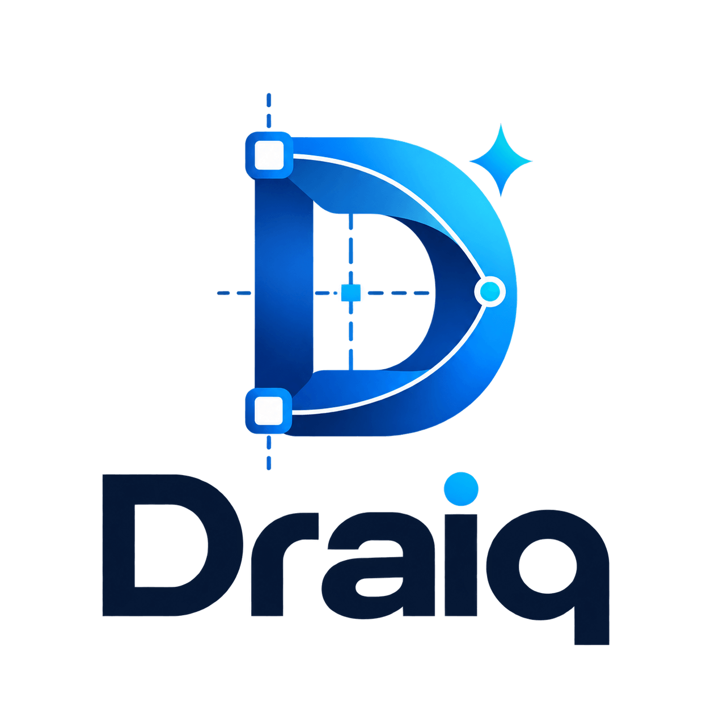
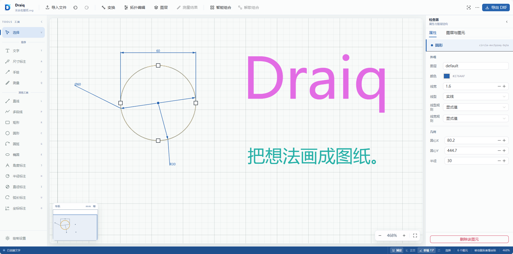

<div align="center">



# Draiq · 智绘

**打开浏览器，把想法画成图纸。**

一款轻量的开源在线二维绘图工具，支持精确绘图、图层管理、尺寸标注与 DXF 文件交换。

[快速开始](#快速开始) · [功能一览](#功能一览) · [部署](#部署) · [参与贡献](CONTRIBUTING.md)


</div>



Draiq 把常用的二维绘图操作放进浏览器：从一条直线开始，也可以导入已有的 SVG 或 DXF，调整几何、整理图层、补充尺寸，再导出 DXF 继续使用。无需注册账号，支持本地运行与自行部署。

## 功能一览

| 能力 | 已支持的内容 |
| --- | --- |
| 基础绘图 | 直线、多段线、矩形、圆、圆弧、椭圆、自由手绘与多行文字 |
| 精确输入 | 绝对坐标、相对坐标、极坐标，以及长度和角度输入 |
| 绘图辅助 | 端点、中点、圆心、交点等对象捕捉，正交约束与极轴追踪 |
| 图元编辑 | 单选、多选、复制、移动、旋转、缩放、镜像与批量属性修改 |
| 几何处理 | 偏移、修剪、延伸、打断、连接、闭合与组合管理 |
| 尺寸与测量 | 线性、角度、半径、直径、弧长、坐标标注，标注样式与关联更新 |
| 图层管理 | 新建、重命名、隐藏、冻结、锁定与图层样式继承 |
| 文件交换 | SVG / DXF 导入，DXF 导出及基于原始 DXF 的合并导出 |
| 工作区 | 缩放、平移、导航缩略图、撤销与重做、自定义画布背景 |

绘制和编辑在浏览器中完成；DXF 导出由配套的 Python 服务处理。

## 快速开始

准备 **Node.js 22.15+**、npm，以及 **Python 3.12 或 3.13**。以下命令均在本仓库根目录执行。

```bash
# 安装前端依赖
npm --prefix web ci

# 创建 Python 虚拟环境
python -m venv .venv
```

激活虚拟环境：

```powershell
# Windows PowerShell
.\.venv\Scripts\Activate.ps1
```

```bash
# macOS / Linux
source .venv/bin/activate
```

安装服务端依赖并启动：

```bash
python -m pip install -r server/requirements.txt
npm run dev
```

打开 **<http://127.0.0.1:8010>**，即可进入绘图工作区。DXF 服务默认监听 `8011`，健康检查地址为 <http://127.0.0.1:8011/api/health>。

也可以在两个终端分别运行 `npm run dev:web` 和 `npm run dev:server`。如果 Python 命令不是 `python`，可在启动 `npm run dev` 前设置 `DRAIQ_PYTHON` 为解释器路径。

### 常用操作

| 操作 | 快捷键 / 手势 |
| --- | --- |
| 选择 / 直线 / 多段线 | `V` / `L` / `P` |
| 矩形 / 圆 / 文字 | `R` / `C` / `T` |
| 尺寸标注 / 测量 | `A` / `Q` |
| 撤销 / 重做 | `Ctrl+Z` / `Ctrl+Shift+Z`，macOS 使用 `⌘` |
| 对象捕捉 / 正交 / 极轴 | `F3` / `F8` / `F10` |
| 适配全部图形 | `Shift+1` |
| 缩放 / 平移 | 滚轮 / 按住鼠标中键拖动 |
| 结束当前操作 | `Esc` |

## 部署

### Docker Compose

```bash
docker compose up --build -d
```

访问 <http://localhost:8010>。前端通过容器内的 `api:8011` 访问 DXF 服务；默认同时映射宿主机 `8011` 端口。

```bash
docker compose logs -f
docker compose down
```

### 手动部署

```bash
npm run typecheck
npm run build
```

在两个终端或由进程管理器分别启动服务：

```bash
python -m uvicorn server.main:app --host 127.0.0.1 --port 8011
```

```bash
npm run start
```

Nuxt 生产服务默认使用 `3000` 端口，可通过 `PORT` 修改。如需更改 DXF 服务地址，在 `web/.env` 中设置 `NUXT_DXF_INTERNAL_URL` 后重新构建，配置示例见 [web/.env.example](web/.env.example)。

## 项目结构

```text
draiq/
├── web/                 Nuxt 3 + Vue 3 + TypeScript 绘图应用
│   ├── components/      画布、工具栏、图层与属性面板
│   ├── composables/     绘图状态、事件与历史管理
│   └── utils/editor/    几何计算、绘图工具、捕捉与文件解析
├── server/              FastAPI + ezdxf 导出服务
├── docker/              前后端镜像构建文件
├── scripts/             本地启动、编辑器打包与品牌素材处理
├── docs/                架构说明与界面素材
└── compose.yaml         Docker Compose 部署入口
```

实现细节见 [架构说明](docs/architecture.md)。前端也可作为 Nuxt Layer 复用，见 [编辑器模块说明](web/README.md)。

## 使用边界

- 当前图纸保存在浏览器内存中，尚未提供图纸自动保存、项目文件保存或云端同步；刷新或关闭页面前请导出 DXF。
- DXF 导入支持常用二维实体。部分复杂实体保留在原始参考层中，无法逐项编辑；合并导出会尽量保留未修改的原始实体，复杂文件建议先用副本验证。
- 支持 SVG 导入和 DXF 导出，目前未提供 SVG、PDF 或图片导出。
- 桌面浏览器体验更完整，小屏会收起部分面板。

## 参与贡献

欢迎通过 Issue 反馈问题或提交 Pull Request。绘图问题请附上复现步骤、浏览器版本，以及可公开的最小 SVG / DXF 样例。

开发约定和提交检查见 [贡献指南](CONTRIBUTING.md)。

## 开源许可

本项目采用 [MIT License](LICENSE)，允许个人和商业使用、修改及分发，使用时须保留版权声明和许可文本。

Copyright © 2026 snihao。第三方依赖仍遵循各自的许可证。
